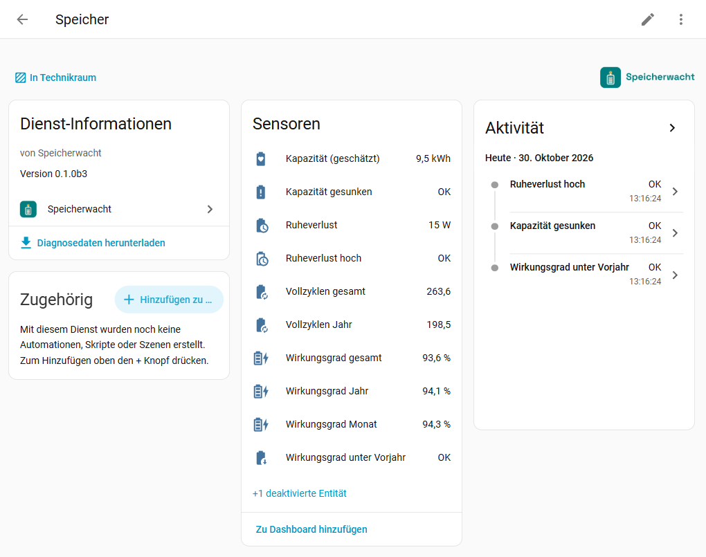
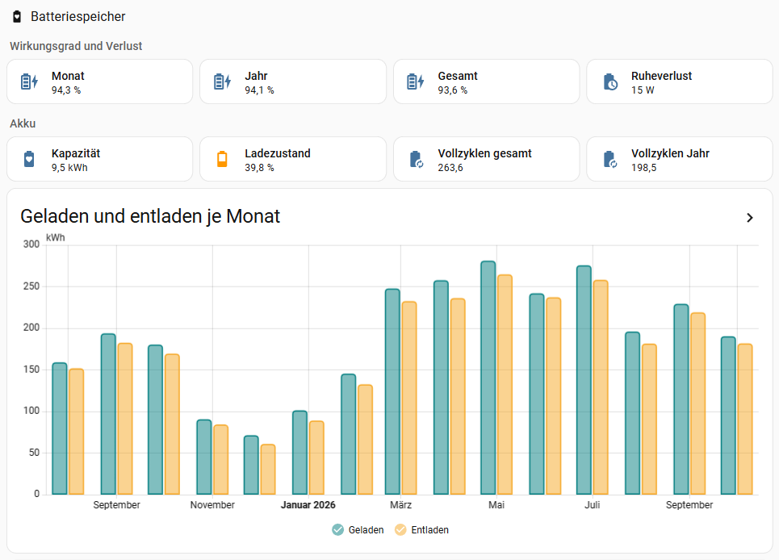

<picture>
  <source media="(prefers-color-scheme: dark)" srcset="https://raw.githubusercontent.com/speicherwacht/integration/main/assets/github/readme-header-dark@2x.png">
  
</picture>

[](https://hacs.xyz/)
[](https://github.com/speicherwacht/integration/releases)
[](https://github.com/speicherwacht/integration/actions/workflows/ci.yml)
[](LICENSE)
[](https://speicherwacht.github.io/integration/?lang=de)

**Deutsch** · [English](https://github.com/speicherwacht/integration/blob/main/README.en.md)

**Wie gut arbeitet mein Batteriespeicher wirklich?** Speicherwacht ist eine Home-Assistant-Integration, die aus den vorhandenen Zählern deines Heim- oder Balkonspeichers den Wirkungsgrad je Monat und Jahr, die Vollzyklen, den Ruheverlust und die tatsächlich entnehmbare Kapazität berechnet – herstellerneutral, nur lesend, ohne Cloud.

**Ausprobieren ohne Installation:** Die [Demo](https://speicherwacht.github.io/integration/?lang=de) zeigt Dashboard, Geräteseite, Gesundheits-Check und Bericht für vier Speicher – gesund, gealtert, Balkonspeicher, frisch eingerichtet – mit erfundenen Werten, aber gerechnet vom Code der Integration.

> **Vorlagen:** Die Vorlage für Fronius ist an einer echten Anlage erprobt, die übrigen stammen aus dem Quellcode der jeweiligen Integration.

## Inhalt

- [Was Speicherwacht kann](#was-speicherwacht-kann) · [Voraussetzungen](#voraussetzungen) · [Installation](#installation) · [Einrichtung](#einrichtung)
- [Entitäten](#entitäten) · [Aktion „Bericht“](#aktion-bericht) · [Gesundheits-Check](#gesundheits-check) · [Wie gerechnet wird](#wie-gerechnet-wird) · [Grenzen der Aussage](#grenzen-der-aussage)
- [Fehlerbehebung](#fehlerbehebung) · [Datenschutz](#datenschutz) · [Entfernen](#entfernen) · [Verwandte Projekte](#verwandte-projekte)

## Was Speicherwacht kann

- **Wirkungsgrad** je Monat, Jahr und gesamt (je Tag abschaltbar): Entladung gegen Ladung, korrigiert um die Änderung des Ladezustands. Ohne diese Korrektur schwankt ein Monatswert mit dem Füllstand am Monatsende.
- **Ruhetage getrennt:** Tage, an denen der Speicher kaum arbeitet (Winter, Notstrom-Reserve, Wartung), zählen nicht in den Wirkungsgrad; ihre Verluste stehen als eigenes Attribut daneben.
- **Vollzyklen** seit Inbetriebnahme und im laufenden Jahr, optional **Garantie-Durchsatz genutzt** in %.
- **Ruheverlust:** mittlere Leistung, die der ruhende Speicher verliert (meist der Eigenverbrauch des Batteriemanagements).
- **Kapazität (geschätzt):** entnehmbare Energie aus Entladungen von voll bis leer, im Vergleich zum Datenblatt.
- **Rückblick ab dem ersten Tag:** Speicherwacht rechnet aus der Langzeitstatistik von Home Assistant, also auch für die Zeit vor der Einrichtung.
- **Bericht für einen beliebigen Zeitraum** per Aktion, je Monat aufgeschlüsselt.
- **Reparaturhinweise**, wenn eine Quelle fehlt, lange nicht verfügbar ist oder eine falsche Einheit hat.
- Keine eigene Speicherdatei, keine zusätzliche Schreiblast auf SD-Karten.



## Voraussetzungen

- Home Assistant **2026.4** oder neuer, mit Recorder.
- Drei Entitäten deines Speichers, jeweils **mit Langzeitstatistik**:
  - **Energie geladen** und **Energie entladen** als Lebenszeit-Zähler (Wh, kWh oder MWh; Zustandsklasse `total` oder `total_increasing`),
  - **Ladezustand** in % (Zustandsklasse `measurement`).
- Die **nutzbare Kapazität** laut Datenblatt.
- **Nur Leistung (W), keine Zähler?** Lege mit dem Helfer *Integral* (Einstellungen → Geräte & Dienste → Helfer → Integral, Methode „Links“) je einen Zähler für Laden und Entladen an. Die Rückschau beginnt dann mit dem Anlegen der Helfer.

## Installation

Speicherwacht steht ab Home Assistant 2026.11 im eingebauten Marketplace, in älteren Versionen in der Standardliste von [HACS](https://hacs.xyz/).

1. *Einstellungen → Marketplace → Durchstöbern*, nach **Speicherwacht** suchen → *Installieren* (vor 2026.11: in HACS → *Herunterladen*).
2. Home Assistant neu starten.
3. *Einstellungen → Geräte & Dienste → Integration hinzufügen → Speicherwacht*.

**Mit einem Klick:** [](https://my.home-assistant.io/redirect/hacs_repository/?owner=speicherwacht&repository=integration&category=integration) → installieren, Home Assistant neu starten → [](https://my.home-assistant.io/redirect/config_flow_start/?domain=speicherwacht)

## Einrichtung

Im ersten Schritt zeigt Speicherwacht die Speicher, die es erkannt hat, und „Eigene Zuordnung“. Im zweiten Schritt prüfst du die Entitäten, trägst die nutzbare Kapazität ein und wählst, was die Zähler messen.

| Quelle | Integration | Stand |
| --- | --- | --- |
| Fronius GEN24 mit Speicher | Core `fronius` mit Modbus TCP (ab HA 2026.9) | erprobt |
| Huawei SUN2000 mit LUNA2000 | [huawei_solar](https://github.com/wlcrs/huawei_solar) | experimentell (beta) |
| Deye und andere über Solarman-Logger | [solarman](https://github.com/davidrapan/ha-solarman) | experimentell (beta) |
| Anker SOLIX Solarbank 1–4 | [anker_solix](https://github.com/thomluther/ha-anker-solix) | experimentell (beta) |
| Anker SOLIX Solarbank 4, Max, XE | [anker_solix_official](https://github.com/anker-charging/ha-anker-solix-official) | experimentell (beta) |
| GoodWe ET, EH, BT, BH | Core `goodwe` | experimentell (beta) |
| Victron mit BMV, SmartShunt oder Lynx | Core `victron_gx` | experimentell (beta) |
| SolarEdge StorEdge | [solaredge_modbus_multi](https://github.com/WillCodeForCats/solaredge-modbus-multi) | experimentell (beta) |
| SolarEdge StorEdge | Core `solaredge_modbus` (ab HA 2026.10) | experimentell (beta) |
| SolaX, Sofar | [solax_modbus](https://github.com/wills106/homeassistant-solax-modbus) | experimentell (beta) |
| Sungrow SH | [Modbus-YAML von mkaiser](https://github.com/mkaiser/Sungrow-SHx-Inverter-Modbus-Home-Assistant) | experimentell (beta) |
| Sigenergy SigenStor | [sigen](https://github.com/TypQxQ/Sigenergy-Local-Modbus) | experimentell (beta) |
| Zendure SolarFlow, Hyper, Hub | [zendure_ha](https://github.com/Zendure/Zendure-HA) | experimentell (beta) |
| Marstek Venus E | [marstek_modbus](https://github.com/ViperRNMC/marstek_venus_modbus) oder [Marstek Modbus Suite](https://github.com/sphings79/marstek-modbus-suite) | experimentell (beta) |
| alle anderen | eigene Zuordnung | – |

- **Eigene Zuordnung:** Hast du den Speicher im Energie-Dashboard eingetragen, übernimmt Speicherwacht Zähler, Ladezustand und Kapazität von dort als Vorschlag. Hast du [Tarifwacht](https://github.com/tarifwacht/integration) mit Speicher eingerichtet, schlägt Speicherwacht sonst die Zähler von dort vor.
- **Fronius:** Ohne Modbus TCP liefert die Integration keine Batteriezähler; dann bleibt die eigene Zuordnung (z. B. mit Integral-Helfern).
- **Anker SOLIX (Cloud):** Die Lebenszeit-Zähler kommen nur per MQTT mit dem Eigentümer-Konto, und die Integration legt sie erst an, wenn du die Kategorie `solarbank_energy` in ihren Optionen nicht mehr ausschließt. Speicherwacht weist in der Einrichtung darauf hin.
- **GoodWe:** Batteriezähler gibt es nur bei ET, EH, BT und BH; ES, EM und BP liefern nur den Ladezustand.
- **Victron:** Die Zähler kommen vom Batteriewächter (BMV, SmartShunt, Lynx). Ein Akku, der nur per CAN-BMS angebunden ist, hat keine. Die Werte „DC-Batterie Lade-/Entladeenergie“ des Systems beginnen bei jedem Neustart bei 0 und taugen nicht.
- **SolarEdge (`solaredge_modbus_multi`):** Batterie-Entitäten gibt es erst mit der Option „Auto-Detect Batteries“. Bei LG- und BYD-Akkus springen die Zähler manchmal auf 0; die Integration hält dann den alten Wert fest, und Speicherwacht meldet „Zähler und Ladezustand passen nicht zusammen“.
- **SolarEdge (Core `solaredge_modbus`):** ein Speicher je Batterie („Battery 1“ bis „Battery 3“). „Energy imported“ ist geladen, „Energy exported“ entladen. Die Kapazität („Usable capacity“) ist ausgeschaltet; eingeschaltet schlägt Speicherwacht sie vor. Fällt ein Zähler zurück, hält die Integration den höchsten Wert fest; dann meldet Speicherwacht „Zähler und Ladezustand passen nicht zusammen“. Wechselrichter, die ihren Akku nicht über Modbus zeigen, haben nur „Storage state of charge“ ohne Zähler. Die gleichnamige HACS-Integration von binsentsu ersetzt die Core-Integration und hat andere Entitäten; dafür die eigene Zuordnung nehmen.
- **SolaX:** „Battery Input Energy Total“ und „Battery Output Energy Total“ sind ausgeschaltet; einschalten und die Integration neu laden. Speicherwacht weist in der Einrichtung darauf hin.
- **Sungrow:** Laut Paket läuft „Battery level“ nur zwischen dem minimalen und maximalen Ladezustand des Wechselrichters von 0 bis 100 %. Die geschätzte Kapazität zeigt dann nur dieses Fenster; ist es deutlich enger als der ganze Akku, trag seine Kapazität ein.
- **Sigenergy:** Speicherwacht nimmt die Zähler der Anlage (ab Modbus-Protokoll v2.7). Ältere Firmware hat sie nicht; dann die Zähler des Wechselrichters selbst zuordnen.
- **Zendure:** Die Zähler rechnet die Integration aus der Akkuleistung hoch, das Gerät hat keine. Speicherwacht prüft dann nur, ob diese Werte stimmig sind. Nach dem Umbenennen des Geräts in der Zendure-App die Entitäten unter *Neu konfigurieren* neu wählen.
- **Marstek:** nur Venus E. Bei Venus A und D läuft der Solarstrom durch den Entladezähler; sie werden nicht erkannt. Die Zähler messen an der Steckdose, also den ganzen Speicher.
- **Die Zähler messen:** *den Akku* (DC, z. B. die Batteriezähler des Wechselrichters) oder *den ganzen Speicher* (AC, z. B. ein Zwischenstecker vor einem Balkonspeicher). Die Werte beider Grenzen sind nicht vergleichbar; AC enthält die Verluste des Wechselrichters.
- **Garantie-Durchsatz (optional):** die Energie in MWh, die die Garantie abdeckt (Garantiebedingungen deines Speichers). Dann entsteht der Sensor „Garantie-Durchsatz genutzt“.
- **Neu konfigurieren:** Geräte & Dienste → Speicherwacht → ⋮ → *Neu konfigurieren*.

Nach der Einrichtung rechnet Speicherwacht nach etwa einer Minute zum ersten Mal und dann jede Stunde (kurz nach :12, wenn Home Assistant die Stundenstatistik geschrieben hat).

### Maxxisun: Einzelakkus summieren

Die Gesamtwerte der Maxxisun-Integration (MaxxiChargeConnect) für Laden und Entladen der Batterie sind gerechnet (PV minus CCU) und lagen in einem geprüften Fall 15–30 % daneben. Die Summe der Leistungen der einzelnen Akkus passte dagegen auf 2–3 % zur Änderung der gespeicherten Energie. Deshalb so zuordnen:

1. Zwei Template-Sensoren (*Einstellungen → Geräte & Dienste → Helfer → Template → Sensor*, Einheit W, Geräteklasse Leistung, Zustandsklasse Messung): die Ladeleistungen aller Akkus addiert und ebenso die Entladeleistungen, z. B. `{{ states('sensor.<akku_1_laden>') | float(0) + states('sensor.<akku_2_laden>') | float(0) }}`.
2. Auf jeden der beiden einen Helfer *Integral* (Methode „Links“, Präfix k, Zeiteinheit Stunden, also kWh). Das sind die Zähler für Laden und Entladen.
3. Den Ladezustand als Template-Sensor aus der gespeicherten Energie (Einheit %, Zustandsklasse Messung):
   ```jinja
   {{ (states('sensor.maxxisun1_batterie_kapazitat') | float(0) / <nutzbare Kapazität in Wh> * 100) | round(1) }}
   ```
   Die nutzbare Kapazität ist die Summe der Akkus; dieselbe Zahl in Speicherwacht eintragen.

Dann in Speicherwacht „Eigene Zuordnung“ wählen und diese drei Entitäten nehmen (Entity-IDs je nach Gerätename). Die Rückschau beginnt mit dem Anlegen der Helfer.

## Entitäten

| Entität | Bedeutung |
| --- | --- |
| Wirkungsgrad Monat / Jahr / gesamt | Entladung + Änderung der gespeicherten Energie, geteilt durch Ladung, über die Betriebstage. „gesamt“ beginnt mit der Langzeitstatistik der Zähler. |
| Wirkungsgrad heute | wie oben für den laufenden Tag; standardmäßig deaktiviert, weil ein einzelner Tag stark vom Ladezustand an den Grenzen abhängt |
| Vollzyklen gesamt | Entladung seit Inbetriebnahme (Zählerstand) geteilt durch die Kapazität |
| Vollzyklen Jahr | Entladung im Kalenderjahr geteilt durch die Kapazität |
| Garantie-Durchsatz genutzt | Entladung seit Inbetriebnahme in % des Garantie-Durchsatzes (nur, wenn eingetragen) |
| Ruheverlust | mittlere Verlustleistung in Ruhephasen der letzten 30 Tage, in W |
| Kapazität (geschätzt) | Median der entnehmbaren Energie je 100 % Ladezustand aus Entladungen von voll bis leer (90 Tage) |
| Bericht für Fehlermeldung | Schaltfläche unter *Diagnose*: zeigt einen kurzen Bericht zum Kopieren in ein Issue, siehe [Fehler melden](#fehler-melden) |

Attribute zeigen, woraus ein Wert entsteht: geladen, entladen, Änderung der gespeicherten Energie, Betriebs- und Ruhetage, Verlust an Ruhetagen, Bilanzgrenze, Zeitraum. Ist ein Wert unbekannt, nennt `reason` den Grund:

| `reason` | Bedeutung |
| --- | --- |
| `not_analysed_yet` | noch nicht gerechnet (etwa eine Minute nach dem Start) |
| `no_recorder` | Recorder nicht aktiv |
| `no_data` | im Zeitraum keine Zählerwerte |
| `too_little_charge` | weniger geladen als eine Kapazität (Tag: eine halbe) |
| `no_soc` | kein Ladezustand an den Tagesgrenzen |
| `too_few_rest_hours` | weniger als 24 Ruhestunden in 30 Tagen |
| `soc_rose_at_rest` | Ladezustand stieg in Ruhephasen – Laden außerhalb der Zähler oder Drift des Ladezustands; der errechnete Wert steht im Attribut `raw_watts` |
| `too_few_discharges` | weniger als drei Entladungen von voll bis leer in 90 Tagen |

Die Sensoren lassen sich wie alle anderen ins Dashboard holen, etwa als Kacheln und mit einem Statistik-Diagramm der Lade- und Entladezähler:



## Aktion „Bericht“

*Einstellungen → Werkzeuge → Aktionen* (früher *Entwicklerwerkzeuge → Aktionen*) → **Speicherwacht: Bericht**, Speicher und Zeitraum wählen, „Antwort anzeigen“. Die Antwort lässt sich auch in Skripten und Automationen verwenden (`response_variable`). Sie enthält dieselben Werte wie die Sensoren, nur für einen beliebigen Zeitraum, auch vor der Einrichtung, und je Monat aufgeschlüsselt.

```yaml
action: speicherwacht.report
data:
  config_entry: <Eintrag auswählen>
  start: "2025-01-01 00:00:00"
  end: "2026-01-01 00:00:00"
```

- **Ohne Beginn:** 1. Januar des laufenden Jahres; **ohne Ende:** jetzt. Ohne beides liefert der Bericht die Werte von „Wirkungsgrad Jahr“ und „Vollzyklen Jahr“. Zeiten ohne Zeitzone gelten als Ortszeit deines Home Assistant.
- **Energie, Wirkungsgrad und Vollzyklen** zählen nur ganze Tage, die im Zeitraum beginnen und enden; den laufenden Tag bis zur letzten Stunde, wenn der Zeitraum bis jetzt reicht. Ruhetage zählen wie bei den Sensoren nicht in den Wirkungsgrad, aber in Energie und Vollzyklen.
- **Ruheverlust** ist das Mittel über alle Ruhestunden des Zeitraums, **Kapazität (geschätzt)** der Median der letzten zehn Entladungen von voll bis leer darin (mit denselben Schwellen wie die Sensoren).
- Der Bericht rechnet aus der Statistik, die Speicherwacht zuletzt gelesen hat (stündlich, `data_until`). Er braucht den Recorder und antwortet erst, wenn Speicherwacht nach dem Start einmal gerechnet hat (etwa eine Minute).

Beispiel-Antwort (erfundene Werte); `reason` hat dieselben Werte wie bei den Sensoren:

```yaml
start: "2026-01-01T00:00:00+01:00"
end: "2026-11-02T14:20:00+01:00"
boundary: battery
capacity_kwh: 10.0
first_day: "2026-01-01"
last_day: "2026-11-02"
days: 306
data_until: "2026-11-02T14:00:00+01:00"
charged_kwh: 2210.45
discharged_kwh: 2051.3
full_cycles: 205.1
efficiency:
  percent: 93.1
  charged_kwh: 2198.7
  discharged_kwh: 2047.9
  stored_change_kwh: -0.6
  operating_days: 291
  rest_days: 15
  rest_loss_kwh: 4.8
  days_without_soc: 0
  incomplete_days: 0
  implausible_days: 0
  reason: null
rest_loss:
  watts: 12
  rest_hours: 1840
  raw_watts: 12.4
  reason: null
capacity_estimate:
  kwh: 9.42
  share_of_data_sheet_percent: 94.2
  samples: 10
  reason: null
hours_implausible:
  count: 0
  hours: []
months:
  - month: "2026-01"
    charged_kwh: 98.2
    discharged_kwh: 88.9
    full_cycles: 8.9
    efficiency_percent: 89.6
    efficiency_operating_days: 24
    efficiency_rest_days: 7
    efficiency_reason: null
  # … ein Eintrag je Monat
```

## Gesundheits-Check

Drei Problem-Sensoren (an = auffällig, unbekannt = noch zu wenig Daten, Grund im Attribut `reason`) und ein Reparaturhinweis. Sie sagen, *was* auffällt, nicht *warum* – keine Fachdiagnose.

| Entität | An, wenn … |
| --- | --- |
| Wirkungsgrad unter Vorjahr | der Wirkungsgrad der letzten 30 Tage mindestens 3 Prozentpunkte unter denselben 30 Tagen des Vorjahres liegt (Vergleich mit dem Vorjahr, weil der Wirkungsgrad mit der Jahreszeit schwankt) |
| Kapazität gesunken | die geschätzte Kapazität unter 80 % des Datenblatts liegt (Lebensende im Feld) oder 10 Punkte unter der Schätzung vor einem Jahr (normal sind 2–3 Punkte pro Jahr) |
| Ruheverlust hoch | der Ruheverlust über 64 W liegt (höchster Stand-by-Wert im Labortest der HTW Berlin) oder mindestens 50 % und 10 W über denselben Tagen des Vorjahres |

**Reparaturhinweis „Zähler und Ladezustand passen nicht zusammen“:** Im letzten Tag hat sich der Ladezustand stark bewegt und die Zähler nicht – oder umgekehrt. Meist hängt ein Zähler, der Ladezustand ist eingefroren oder eine Entität ist falsch zugeordnet.

Die Vergleiche mit dem Vorjahr brauchen ein Jahr Langzeitstatistik; vorher sind diese Prüfungen unbekannt. Regeln, Quellen und Schwellen: [docs/GESUNDHEITSCHECK.md](docs/GESUNDHEITSCHECK.md).

## Wie gerechnet wird

- **Grundlage** sind die Stundenwerte der Langzeitstatistik. Speicherwacht liest den Zählerstand je Stunde und fängt Rücksprünge, Neustarts des Zählers und Ausreißer selbst ab (manche Integrationen melden Zähler ohne Reset-Kennung oder kurz einen falschen Wert).
- **Unplausible Stunden:** Steigt ein Zähler in einer Stunde um mehr, als der Speicher laden oder entladen kann (doppelte Kapazität je Stunde × 1,5 + 1 kWh), oder fängt ein Gesamtzähler neu an, ist die Energie dieser Stunde unbekannt – etwa wenn eine Quelle kurz Wh als kWh meldet (107 → 109.851,5 → 110,1). Solche Stunden lässt Speicherwacht aus Ruheverlust und Kapazität heraus, ihre Tage aus dem Wirkungsgrad (Attribut `implausible_days`); in den Vollzyklen fehlt die Energie dieser Stunden. Die Aktion „Bericht“ nennt sie unter `hours_implausible` (Anzahl und die ersten fünf), die Diagnose-Datei ebenso.
- **Korrektur über den Ladezustand:** Wirkungsgrad = (Entladung + ΔLadezustand × Kapazität) / Ladung. Das ist eine **eigene Näherung**: Prüfstände wie die HTW-Stromspeicher-Inspektion messen stattdessen nur zwischen gleichen Ladezuständen (voll → leer → voll). Über einen Monat oder ein Jahr bleibt der Unterschied klein (unter 1 %), weil der Durchsatz viele Kapazitäten beträgt; einzelne Tage schwanken stärker.
- **Ruhetag:** Laden und Entladen jeweils unter 5 % der Kapazität.
- **Ruheverlust:** Abfall des Ladezustands in Stunden ohne nennenswertes Laden oder Entladen, mindestens drei Stunden am Stück.
- **Kapazität (geschätzt):** nur aus Entladungen von mindestens 90 % bis höchstens 15 % Ladezustand, ohne Laden dazwischen. Kleinere Hübe zählen nicht, weil der Ladezustand vom Batteriemanagement berechnet wird und sonst nur dessen eigene Annahme zurückkäme.
- **Vollzyklen** zählen wie die Garantien die abgegebene Energie.

Quellen und Begründungen: [docs/ENTWICKLUNG.md](docs/ENTWICKLUNG.md), Abschnitt 3.

## Grenzen der Aussage

- Speicherwacht ist eine **Orientierung, keine Fachdiagnose**. Es rechnet mit den Zählern deines Wechselrichters bzw. Speichers – sind die ungenau, sind es die Ergebnisse auch.
- Der Ladezustand ist bei LFP-Akkus ein berechneter Wert und kann springen (z. B. bei einer Kalibrierladung). Ein Sprung an einer Monatsgrenze verschiebt den Wirkungsgrad dieses Monats etwas.
- Ein Labor-Batteriewirkungsgrad (DC) liegt bei aktuellen Heimspeichern um 95–97 %. Im Alltag liegen Werte darunter: Teillast, Eigenverbrauch des Batteriemanagements und Ruhephasen kosten Energie. AC-Werte (Bilanzgrenze „ganzer Speicher“) enthalten zusätzlich die Wandlerverluste.
- Die geschätzte Kapazität streut. Für LFP-Akkus nennt eine Feldstudie der RWTH Aachen (Figgener et al. 2024) rund ±8 Prozentpunkte für ein ausgefeilteres Verfahren. Achte auf den Verlauf über Monate, nicht auf einen Einzelwert.

## Fehlerbehebung

- **Reparaturhinweis „Entität fehlt“, „Quelle nicht erreichbar“ oder „unerwartete Einheit“:** Quell-Integration prüfen oder unter *Neu konfigurieren* andere Entitäten wählen. Die Hinweise verschwinden von selbst.
- **Reparaturhinweis „eigener Sensor als Quelle“:** Ein Eintrag nutzt einen Sensor von Speicherwacht selbst als Quelle (möglich bis 0.1.3, meist ein Wirkungsgrad als Ladezustand) und würde damit seine eigenen Ergebnisse lesen. Speicherwacht liest einen solchen Ladezustand nicht; Wirkungsgrad, Ruheverlust und Kapazität bleiben unbekannt. Unter *Speicherwacht → ⋮ → Neu konfigurieren* den Ladezustand des Speichers wählen, danach rechnet Speicherwacht alles neu.
- **Quelle umbenannt** (Entity-ID geändert, auch über „Entity-IDs neu erstellen“): Speicherwacht zieht die neue ID seit 0.1.1 selbst nach und lädt den Eintrag kurz danach neu; *Neu konfigurieren* ist nicht nötig. Der Verlauf bleibt erhalten, weil Home Assistant die Statistik mit umbenennt. Nur eine gelöschte Entität meldet „Entität fehlt“.
- **Reparaturhinweis „Zähler beginnt jeden Tag neu“ oder Warnung „Tageszähler“ in der Einrichtung:** Ein Zähler fiel an mehreren Tagen zur selben Uhrzeit zurück, wie ein Zähler „Energie heute“. Speicherwacht braucht Gesamtzähler (Lebenszeit); unter *Neu konfigurieren* den passenden wählen. Ist es doch ein Gesamtzähler, den Hinweis ignorieren bzw. in der Einrichtung unverändert noch einmal absenden.
- **Alle Werte bleiben unbekannt:** Haben die Zähler und der Ladezustand Langzeitstatistik? *Werkzeuge → Statistik* (vor 2026.8: Entwicklerwerkzeuge) zeigt es. Ohne Zustandsklasse gibt es keine.
- **Wirkungsgrad über 100 %:** Meist messen Lade- und Entladezähler an verschiedenen Stellen, Energie fließt am Ladezähler vorbei in den Akku (etwa PV direkt in den Akku bei DC-gekoppelten Balkonspeichern), oder der Ladezustand ist falsch zugeordnet.
- **Ruheverlust unbekannt mit `soc_rose_at_rest`:** In Stunden ohne Laden und Entladen stieg der Ladezustand. Dann lädt etwas am Ladezähler vorbei (siehe oben) oder der Ladezustand driftet. Bis auf eine Stufe des Ladezustands (1 %) über alle Ruhestunden zeigt Speicherwacht 0 W, weil das Rundung sein kann. Der Gesundheits-Check „Ruheverlust hoch“ bleibt dann unbekannt.
- **Bericht für Fehlermeldung:** Schaltfläche am Gerät unter *Diagnose*, siehe [Fehler melden](#fehler-melden). **Diagnose-Datei:** Geräte & Dienste → Speicherwacht → ⋮ → *Diagnose herunterladen*; sie enthält auch die vom Zählerbaustein verworfenen Werte.

## Datenschutz

Speicherwacht ruft nichts aus dem Netz ab und sendet nichts. Die Diagnose-Datei enthält Energiesummen und die Zustände deiner Quell-Entitäten – prüfe sie, bevor du sie teilst. Für eine Fehlermeldung reicht meist der kürzere [Bericht für Fehlermeldung](#fehler-melden).

## Entfernen

Geräte & Dienste → Speicherwacht → ⋮ → *Löschen*. Speicherwacht legt keine Dateien an; die Langzeitstatistik der eigenen Sensoren bleibt im Recorder, bis du sie unter *Werkzeuge → Statistik* (vor 2026.8: Entwicklerwerkzeuge) löschst. Danach im Marketplace deinstallieren (vor 2026.11: in HACS entfernen).

## Fehler melden

[Issue anlegen](https://github.com/speicherwacht/integration/issues/new/choose), mit Speichermodell, Integration und dem **Bericht für Fehlermeldung**: *Geräte & Dienste → Speicherwacht → Gerät des Speichers → Diagnose → Bericht für Fehlermeldung* drücken (nicht zu verwechseln mit der Aktion „Bericht“). Der Bericht erscheint als Benachrichtigung (Glocke unten links) zum Kopieren. Er enthält Versionen, die Zuordnung nach Rolle (Integration, Einheit, Klassen, Zustand von Lade-, Entladezähler und Ladezustand), Kapazität, Bilanzgrenze und Garantie-Durchsatz, die Vorlage, wie viele Stunden Statistik vorliegen und welche Zählerwerte verworfen wurden, welche Sensoren unbekannt sind und warum, und offene Reparaturhinweise. Entity-IDs, Namen und Bereiche stehen nicht darin. Lies ihn trotzdem vor dem Teilen und lösche, was du nicht zeigen willst. Sicherheitslücken bitte vertraulich, siehe [SECURITY.md](https://github.com/speicherwacht/integration/blob/main/SECURITY.md).

### Was steht in der Diagnose-Datei?

Reicht der Bericht nicht, kommt im Issue die Bitte um die Diagnose-Datei (*⋮ → Diagnose herunterladen*). Sie ist ausführlicher, und nicht alles darin kommt von Speicherwacht:

- **Von Home Assistant** (jede Integration hat diesen Kopf, Speicherwacht kann ihn nicht ändern): Version und Installationsart, Betriebssystem, Zeitzone und unter `custom_components` die Liste **aller** installierten benutzerdefinierten Integrationen mit Versionen. Diese Blöcke darfst du vor dem Hochladen löschen, sie werden nicht gebraucht.
- **Von Speicherwacht** (unter `data`): die Einstellungen des Eintrags samt dem Namen, den du vergeben hast, und den Entity-IDs der Quellen, deren aktuelle Zustände (also Zählerstände und Ladezustand), Anzahl und Zeitraum der Stunden aus der Statistik, die letzten vom Zählerbaustein verworfenen Werte mit Uhrzeit und alle Kennzahlen mit ihren Energiesummen. Speicherwacht ersetzt darin nichts durch erfundene Werte; Namen oder Entity-IDs, die du nicht zeigen willst, darfst du vor dem Hochladen ändern.

Willst du die Datei nicht öffentlich teilen, ist das in Ordnung: Dann reichen meist der Bericht und gezielte Angaben, nach denen im Issue gefragt wird.

Pull Requests sind willkommen. Wie, steht in [CONTRIBUTING.md](https://github.com/speicherwacht/integration/blob/main/CONTRIBUTING.md).

## Verwandte Projekte

- [Marstek Capacity Monitor](https://github.com/satscan1/marstek-capacity-monitor): Kapazitätsmessung, Zyklen und SoC-Drift für Marstek-Speicher. Für Marstek tiefer als Speicherwacht.
- [battery_sim](https://github.com/hif2k1/battery_sim): simuliert, was ein Speicher bringen würde – für die Zeit vor dem Kauf.
- Viele Hersteller-Integrationen (Zendure, Anker SOLIX, Marstek) zeigen eigene Wirkungsgrade, meist Entladung / Ladung ohne Korrektur über den Ladezustand.

## Weitere Wachten

Vom selben Autor und nach demselben Muster gebaut: Einrichtung über die Oberfläche, deutsch und englisch, schonend für SD-Karten.

- **Energie**
  - [Einspeisewacht](https://github.com/einspeisewacht/integration) – was negative Strompreise bei der PV-Einspeisung kosten (§ 51 EEG) · [Demo](https://einspeisewacht.github.io/integration/?lang=de)
  - [Tarifwacht](https://github.com/tarifwacht/integration) – was der eigene Strombezug mit anderen Tarifen gekostet hätte, auch dynamisch und mit Modul 3 · [Demo](https://tarifwacht.github.io/integration/?lang=de)
  - [Wärmewacht](https://github.com/waermewacht/integration) – Arbeitszahlen und Gesundheits-Check der Wärmepumpe · [Demo](https://waermewacht.github.io/integration/?lang=de)
- **Alltag**
  - [Eilwacht](https://github.com/eilwacht/integration) – Tagesschau-Eilmeldungen und Regionalnachrichten als Auslöser für Automationen · [Demo](https://eilwacht.github.io/integration/?lang=de)
  - [Streckenwacht](https://github.com/streckenwacht/integration) – Baustellen, Sperrungen und Staus auf den eigenen Strecken · [Demo](https://streckenwacht.github.io/integration/?lang=de)

## Lizenz

MIT, siehe [LICENSE](LICENSE).
